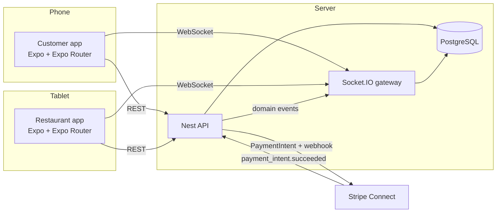
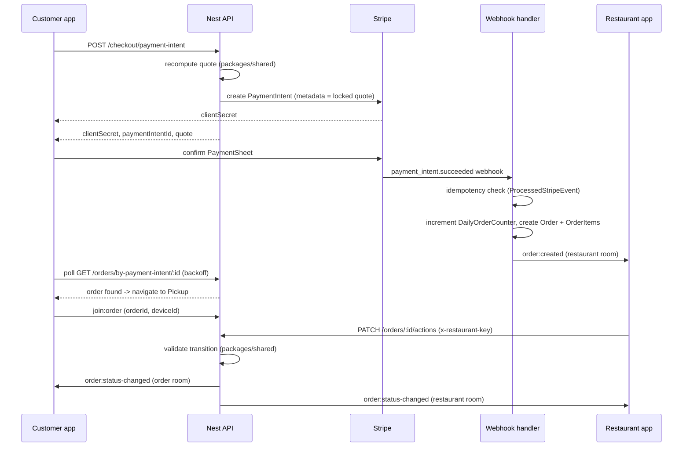

# Architecture

## System overview

`packages/shared` sits underneath both Expo apps and the API: money math, the
deal engine, the order state machine, and the Socket.IO event contracts are
defined once and imported everywhere, so pricing and status logic can never
drift between client and server. `packages/ui-native` sits underneath both
Expo apps only: themed primitives, the API client, and the socket provider.

## API module boundaries

- `config` — Zod-validated environment variables.
- `prisma` — the single `PrismaService`, global so every module can inject it.
- `restaurants` — read-only catalog (`GET /restaurants`, `GET /restaurants/:id`),
  maps Prisma rows into the shared `Restaurant` shape.
- `customers` — `POST /customers`, upserts a customer by device id.
- `checkout` — `POST /checkout/quote`, `POST /checkout/payment-intent`. Recomputes
  pricing server-side with `packages/shared`, rejects paused restaurants and
  mixed carts, locks the computed totals into the Stripe PaymentIntent's
  metadata.
- `payments` — the Stripe webhook endpoint and the `StripeClient` provider
  (`checkout` and `orders` depend on this abstraction, never on the `stripe`
  package directly, so tests can swap in a fake).
- `orders` — order creation (triggered only by the webhook), queries, status
  transitions, restaurant availability. Emits domain events through
  `@nestjs/event-emitter`; it has no dependency on the realtime gateway.
- `realtime` — the Socket.IO gateway and an `EventsPublisher` that listens for
  the domain events `orders` emits and turns them into room broadcasts. This
  is the only module that imports the gateway, which is what keeps `orders`
  framework-agnostic and easy to unit test.
- `health` — `GET /health`, checks the database connection.

## Order lifecycle

The webhook is the **only** path that creates an `Order` row — see
[ADR 0002](./adr/0002-orders-only-from-webhooks.md). The client never writes
an order directly; it only ever asks "has the webhook created my order yet?"
by polling `GET /orders/by-payment-intent/:id` with backoff, since the
webhook can arrive a moment after `presentPaymentSheet()` resolves.

## Realtime rooms

See [docs/SOCKET_EVENTS.md](./SOCKET_EVENTS.md) and
[ADR 0001](./adr/0001-realtime-rooms.md) for the full contract. In short:

- every socket auto-joins a public `restaurants` room on connect, for
  Open/Paused broadcasts;
- a customer must prove device ownership of an order id to join `order:{id}`;
- a restaurant tablet must present its demo key to join `restaurant:{id}`.

## Money and pricing

All money is integer cents from the database up through the API response. The
only place a dollar string is ever formatted is `formatCents` in
`packages/shared`, called from UI components. See
[ADR 0003](./adr/0003-money-in-cents-pricing-in-shared.md).
